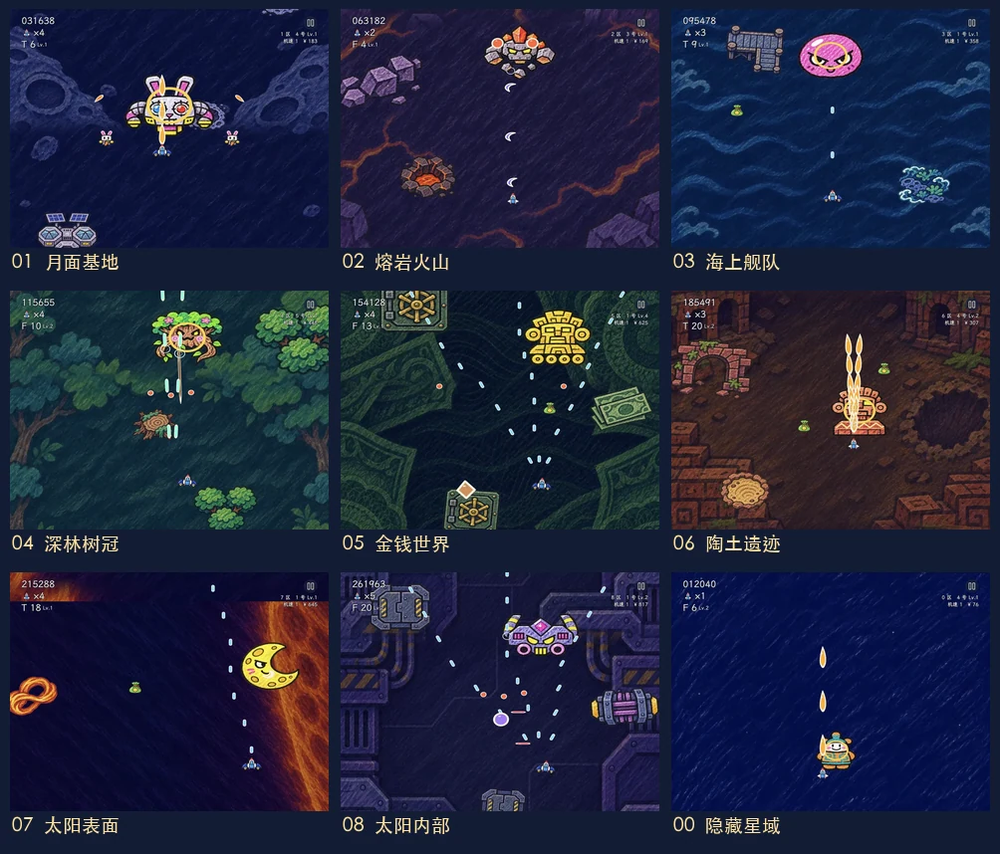

# 安装版验收记录

2026 年 11 月 25 日，在本机 macOS 27.2.1、Apple Silicon 上验收。应用入口为「花园王国 → 加纳战机」。两次独立的正式安装版飞行均从月面基地连续打到结局，随后分别解锁并打通隐藏区，再经商店返回第一关。

## 飞行记录

键盘主线 **42 分 38 秒**，模拟 Xbox 主线 **42 分 39 秒**。表中为两名测试飞手各自的有效游玩时间，关间选购、暂停和退出重开期间停表。两次主线均未用尽残机。截图来自正常战斗中的安装版窗口，保留玩家、弹道和界面。

| 区域 | 实际通过的遭遇 | 键盘 | 模拟 Xbox | 实机截图 |
| --- | --- | ---: | ---: | --- |
| 1 月面基地 | 浮空球、机械兔双眼 | 5′02″ | 5′53″ | [航线](screens/area-1-route.webp) · [首领](screens/area-1-boss.webp) |
| 2 熔岩火山 | 炮台、熔岩守卫冲撞 | 6′32″ | 6′47″ | [航线](screens/area-2-route.webp) · [首领](screens/area-2-boss.webp) |
| 3 海上舰队 | 双潮海妖、水纹和触手 | 5′09″ | 5′21″ | [航线](screens/area-3-route.webp) · [首领](screens/area-3-boss.webp) |
| 4 深林树冠 | 巨橡果、树精回收长枝 | 5′31″ | 4′04″ | [航线](screens/area-4-route.webp) · [首领](screens/area-4-boss.webp) |
| 5 金钱世界 | 招财猫、金币与翻砖 | 4′41″ | 4′43″ | [航线](screens/area-5-route.webp) · [首领](screens/area-5-boss.webp) |
| 6 陶土遗迹 | 陶偶激光、石像出沙 | 4′58″ | 4′34″ | [航线](screens/area-6-route.webp) · [首领](screens/area-6-boss.webp) |
| 7 太阳表面 | 无中段首领，弯月弹可击破 | 5′04″ | 5′05″ | [航线](screens/area-7-route.webp) · [首领](screens/area-7-boss.webp) |
| 8 太阳内部 | 依次再战三名中段首领，地底异兽后进入要塞核心与结局 | 5′41″ | 6′11″ | [航线](screens/area-8-route.webp) · [首领](screens/area-8-boss.webp) |
| 0 隐藏星域 | 陶偶后进入补给站，接回第一区 | 3′07″ | 3′07″ | [航线](screens/area-0-route.webp) · [首领](screens/area-0-boss.webp) |

两次跑图使用独立临时存档和相同的初始随机种子。测试飞手读取画面对应的游戏状态，向实际键盘事件或标准 Gamepad 接口送入操作。在加速回放中逐帧执行移动、开火、碰撞、拾取和首领逻辑，抽取关键帧作图。测试飞手没有跳关、补钱、改首领血量或开启无敌。模拟手柄还用 A、方向键、LB / RB 走过首页、机库、关间商店和声音测试选区。

[机库](screens/hangar.webp) · [补给站](screens/shop.webp) · [隐藏区设置](screens/hidden-setting.webp) · [八区结局](screens/ending.webp)

## 中断与恢复

三次都通过桌面程序自己的退出流程关闭进程，再打开同一个隔离用户目录，从首页进入机库。逐一对比了退出前和载入后全部持久状态，包括敌人、子弹、掉落物、首领两只眼的耐久、玩家位置、残机和预送订单。待播放的一次性音效会清空。

| 中断点 | 飞行总帧 | 结果 |
| --- | ---: | --- |
| 第一区弹幕中 | 719 | 读回同一批敌弹、玩家位置与拾取物，继续飞行。 |
| 机械兔约半血 | 16,801 | 两眼血量、攻击计时和场上弹道逐项一致。 |
| 第一区商店购买后 | 18,143 | 一枚预送弹将钱包从 ¥177 扣到 ¥173。重开后仍是 ¥173、一枚订单，出发时入库一次。 |

另外验证了命数耗尽时从本区重来、重复点出发、预送与终关转换上限、损坏存档回到机库，以及失焦和手柄断连后等待主动继续。三处进程重开和整局通关均使用隔离数据，测试成绩没有写入家庭存档。

## 与指定 FC 汉化版的对照

直接运行指定的美版汉化 v1.0。开场定帧重放使用相同的逻辑输入，连续向右 20 帧并按住基础枪。读原版逐帧画面和精灵位置，按 256 × 240 的逻辑坐标比较。另用原版设置的选区和关闭死亡功能分区观察后段，不改游戏数据；这项辅助只用于参考游戏的关卡取样。[指定版本](https://zaixianwan.app/zh-Hans/games/968) · [美版说明书](https://www.thegameisafootarcade.com/wp-content/uploads/2017/02/Gun-Nac-Game-Manual.pdf)

| 对照项 | 原版观察 | JS 安装版 |
| --- | --- | --- |
| 小飞机起始位置 | 中心约 (128, 161) | (128, 161) |
| 四档横移，持续 20 帧 | 整像素位移 56 / 75 / 93 / 112 | 取整后 56 / 75 / 93 / 112 |
| 基础直射 | 每 7 帧一发，纵向 9 像素/帧，相邻两发相距 63 像素 | 7 帧、9 像素/帧、63 像素 |
| 首波补给兵与落物 | 第 108 帧可见；第一、二枚枪标记分别在第 205、285 帧出现 | 第 108 帧入场，标记在第 205、298 帧出现 |
| 星空进入月面 | 画面近上缘第 1,395 帧进入月面，近下缘第 1,419 帧进入 | 地表从第 1,392 帧开始以 8 像素/帧入屏 |
| 机械兔双眼 | 固定机身，睁眼周期 180 帧，红色弱点持续 68 帧。两眼中心约 (119, 100)、(137, 100) | 周期 180 帧，其中 68 帧可以击中；两眼独立判定和停火 |
| 胡萝卜弹 | 第一对从两侧向外飞，再弯向玩家。观察 12 帧区间位移约 16～17 像素 | 普通档侧发初速约 1.40 像素/帧，转向后沿当前方向飞行 |
| 碰撞 | 一次普通弹与小飞机的取样中，精灵位置估算相距约 7 像素时尚未扣命，下一帧约 6 像素时扣命 | 小飞机中心半径 2.5，常规敌弹半径 2.5，胡萝卜弹半径 3。大型敌人与装翼飞机使用各自的判定 |
| 终关 | 要塞中依次见到浮空球、橡果、重炮台。终战先见钻出的异兽，再见金色异形头部，随后是通关画面与片尾 | 三次再战、两阶段首领、折向光束与落底散泡依次接入结局 |

原版后段每 600 帧取样，核对地图主题、中段与终点首领、出场顺序和片尾。按这些观察调整了各区首领前后的航程，隐藏区也有独立的长航线。固定输入测试还保留了具体差异。第二枚枪标记在重写版晚 13 帧，部分编队的敌数、入场镜像、掉落、判定形状与首领击破耗时仍会不同。画面按彩笔分镜重绘，曲调、打击声、商店和结局画面均为本应用制作。[逐关记录](https://gamefaqs.gamespot.com/nes/587323-gun-nac/faqs/52597) · [原版完整通关记录](https://www.youtube.com/watch?v=j0zaQDYGaTk)

## 桌面、显示与回归

- 使用项目的 `python3 build.py` 构建、验签、替换安装并启动正式版。319 项项目测试（含 8 项独立飞行用例）和 1 项性能测试全部通过，另跑的 4 项 Sites 测试通过。Sites 的客户端、服务端入口和托管配置均存在。
- Electron 桌面测试通过窗口模式、关闭时保存和重开续玩。项目原有的标准手柄模拟套件通过菜单导航、跳台战斗、三个小游戏的完整流程、选项、奖励与复活。桌面自动化为同时打开的测试窗口固定了模拟焦点；失焦操作另有单独用例。
- 在正式安装版从首页进入彩虹花园，选姐姐并实际起步。还分别进入「找回彩虹」「照顾花朵」「甜蜜分享」，操作提示后返回。以上检查均未捕获未处理的渲染错误。
- 使用真实显示时钟、正常 GPU 绘制和持续射击另测了 240 个刷新间隔。窄窗口测得中位 16.6 毫秒，95 分位 18.6 毫秒。窗口、全屏和 610 × 420 的窄视口均维持 4∶3，战场没有水平溢出。另从第八关重炮台再战开始，以全屏和正常速度连续游玩 65 秒。采集到 3,896 个刷新间隔，中位 16.7 毫秒，95 分位 18.6 毫秒，最长 50.1 毫秒，期间未捕获未处理异常。时间数据仅代表本机这次取样。
- 另将桌面 Chromium 切换到离线模式，确认 `navigator.onLine` 为 false，并将外部代理指向未监听的本机端口。在此状态下从首页加载本地美术、启动音频、打完第一关、购买并寄送炸弹、三次退出重开，再飞入第二区。较早尝试的 macOS 嵌套进程沙箱会阻止 Chromium 初始化 GPU，该实验未计入正常启动与离线通关记录。
- macOS 两次主线和隐藏区运行期间，游戏渲染进程的外部 HTTP(S) 请求被拦截，记录为零次外部资源请求。核对了 Mac 和两种 Windows 架构的封包，战斗代码与 13 份美术文件均与构建输出一致。封包中没有原作游戏映像或家庭数据库。
- Windows x64 与 ARM64 安装包在 macOS 交叉构建，两个 NSIS 包均通过完整性检查。Windows 系统中的安装、运行、音频与显卡驱动尚未经实机验证。手柄覆盖标准 Xbox 输入模拟，实体 USB / 蓝牙手柄尚未验收。

可在项目根目录运行 `node --test tests/gun-nac.test.mjs` 重放固定输入与九区逻辑飞行。
